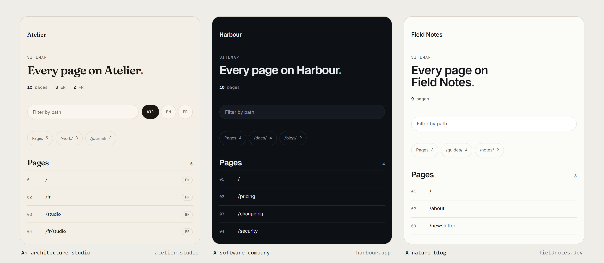

# maisongr-sitemap

**One sitemap, two readers.** Search engines get the XML they need. A person who opens `/sitemap.xml` gets a page in your site's own colours, fonts and dark mode, with every address as a link and a filter.

[](https://www.npmjs.com/package/maisongr-sitemap)
[](https://github.com/maison-gr/sitemap/actions/workflows/ci.yml)
[](LICENSE)


```sh
npx maisongr-sitemap init
```

`init` detects your framework, finds your pages, dates each one from Git, reads your theme, and writes one route file. There's nothing to design and nothing to keep in sync.

## It takes your site's design

The page reads your colours, fonts and dark mode from your own stylesheets. The same package, on three example sites:



## How it compares

| | **maisongr-sitemap** | next-sitemap | @astrojs/sitemap |
|---|---|---|---|
| Frameworks | Next.js, Astro, SvelteKit, Nuxt, Express, any `Request`/`Response` server, single-page apps, any static site, any language through `crawl` | Next.js | Astro |
| What a person sees at `/sitemap.xml` | A page in your site's design | Raw XML | XML styled with your own XSL |
| `lastmod` | The last commit that changed each page | Build time, by default | What you set |
| `hreflang` alternates | Read from your routes and i18n config | Configured | From its `i18n` option |
| Images, videos, news | Yes | Through `transform` | Not documented per page |
| Several sitemaps | Yes | Yes | Yes |
| `robots.txt` | Says when it's missing the sitemap | Generates it | No |
| IndexNow | `maisongr-sitemap indexnow` | No | No |
| Strict CSP (`default-src 'self'`) | Works as is | Raw XML (nothing to load) | Depends on your XSL |

## Why

- **Browsers are removing XSLT.** A sitemap styled with an `.xsl` file now opens on a warning, or not at all.
- **Hand-written sitemaps drift.** A new page, a new language or a renamed route is forgotten until Search Console complains.
- **`<lastmod>` is usually false.** Most generators stamp the build time on every page, so Google and Bing learn to ignore it. This one uses the date of the last commit that changed each page.

## Works with

| | What `init` sets up |
|---|---|
| **Next.js** (App and Pages Router) | `app/sitemap.xml/route.ts` |
| **Astro** with an adapter | `src/pages/sitemap.xml.ts`, rendered on demand |
| **SvelteKit** | `src/routes/sitemap.xml/+server.ts` |
| **Nuxt** 3 and 4 | `server/routes/sitemap.xml.ts` |
| **Static builds**: Astro without an adapter, SvelteKit with `adapter-static`, `nuxt generate` | Static mode, run after your build |
| **Express**, Connect, Polka, `node:http` | `sitemap.js` beside the server's entry, themed from the frontend it serves (see [Express](#express-and-nodehttp)) |
| **Anything that speaks `Request` and `Response`**: Hono, Cloudflare Workers, Bun, Deno, React Router | The [handler](#any-other-server) itself |
| **Single-page apps**: Vite (React, Vue, Solid, Svelte, Preact) and Create React App | Static mode after your build, with the pages read from your router (see [Single-page apps](#single-page-apps)) |
| **Any static site**: hand-written HTML, Eleventy, Hugo, Jekyll, any generator | [`static`](#static-sites) on the build output |
| **Any other language**: PHP (Laravel, WordPress, Symfony), Python, Ruby, Go, Java, .NET, a CMS | [`crawl`](#any-site-in-any-language) reads the running site |

Each one has been checked on a real production build: Next.js 15 and 16 (App Router, Pages Router and `cacheComponents`), Astro 7, SvelteKit 3, Nuxt 4 (with `@nuxtjs/i18n`), Express 5, Hono 4, React Router 8, a Vite React app, Eleventy 3, a hand-written HTML site and a server that renders each page on request. The handler also runs on Bun 1.4 and Deno 2.9.

## What `init` does

1. **Detects** the framework, and whether the site runs a server or builds static files.
2. **Finds the pages** from your route files, following each framework's rules: route groups, private folders, optional and rest parameters, matchers, ignored files. It leaves out:
   - pages marked `noindex`: in metadata, in a robots meta tag, through a layout prop such as `<Layout noindex />`, or through a helper such as `privatePageMetadata()`;
   - sign-in, account, admin, checkout and developer pages, wherever the word appears in the name (`account-recovery`, `confirm-email-change`), but not inside another word (`accounting` stays). Pass `exclude` for anything else that's private.

   Every page it leaves out is listed, with the reason.
3. **Finds your languages**. Each language version is its own entry, with `hreflang` alternates and `x-default`. It reads:
   - `[locale]` or `[lang]` route folders;
   - Next.js middleware that puts every page under `/{language}/`;
   - Astro's `i18n`, with one folder per language (`src/pages/fr/about.astro`);
   - `@nuxtjs/i18n` and its `strategy`.

   A default language served without a prefix (`/about` beside `/fr/about`) is followed too.
4. **Dates every page** from Git (see [Dates](#dates)).
5. **Reads your theme**:
   - colour tokens, light and dark: shadcn, Tailwind v4 `@theme`, or plain CSS variables, in stylesheets or in a layout's `<style>`;
   - fonts: `next/font`, your own `@font-face` files, Fontsource packages, Astro's Fonts API, or the family your CSS names, fetched once from Google Fonts. All are served from your own domain under `/_sitemap/`;
   - your site's name and icon.
6. **Reads your config**: the site address, and the base path and trailing slash (Next.js `basePath` and `trailingSlash`, Astro `site`, `base` and `trailingSlash`, SvelteKit `paths.base`, Nuxt `app.baseURL` and `site.url`). No address in the sitemap redirects.
7. **Writes** the route and its `manifest.json`, then puts `maisongr-sitemap build` at the start of your `build` script, so every build re-reads all of it. It goes in `build` itself, not `prebuild`, because pnpm and Yarn 2+ never run `prebuild`.

If another file or package already serves `/sitemap.xml` (`next-sitemap`, `@astrojs/sitemap`, `@nuxtjs/sitemap`, a `public/sitemap.xml`), `init` stops and says so, before writing anything.

Then install it: `npm install maisongr-sitemap`.

## The route

The Next.js route, as `init` writes it:

```ts
import { sitemap } from "maisongr-sitemap/next";
import manifest from "./manifest.json";

export const dynamic = "force-dynamic";

export const GET = sitemap({
  manifest,
  // Dynamic routes are listed once you give their values:
  params: {
    "/blog/[slug]": async () => (await getPosts()).map((p) => ({ slug: p.slug, lastmod: p.updatedAt })),
  },
});
```

A dynamic page that exports `generateStaticParams` needs no `params` entry: the route lists the values that function returns.

With Next.js 16's `cacheComponents`, `init` leaves out the `dynamic` line, which that mode refuses. The route stays dynamic because it reads the request.

Astro, SvelteKit and Nuxt routes call `createSitemap` from `maisongr-sitemap` with the same options.

| Option | |
|---|---|
| `manifest` | What the build step wrote. Without one, the sitemap lists `entries` alone, in a neutral theme. |
| `params` | Values for dynamic routes, keyed by the route as the build report names it (`"/blog/[slug]"`). Each row may carry its own `lastmod` and `images`. |
| `entries` | Extra addresses no route file describes. A `loc` may be a path (`"/press"`). Each may carry `images`, `videos` and `news`. |
| `sitemaps` | More sitemaps, by name (see [Several sitemaps](#several-sitemaps)). |
| `exclude` | Paths to leave out, from routes and `entries` alike: exact (`"/thanks"`), prefix (`"/drafts/"`) or `RegExp`. |
| `transform` | Called with each entry before it's listed. Return it changed (to add `images`, say) or `null` to leave it out. |
| `site` | The address the site is served at. Defaults to the manifest's, then the request's. |
| `basePath`, `trailingSlash` | Override what was read from your config. |
| `locales` | Override the detected languages: `{ list, default, prefix?, prefixDefault?, folders? }`. |
| `revalidate` | Seconds the list is kept before `params` and `entries` run again. Default 3600. A failed load is not kept. To list new content at once, call the handler's `invalidate()` when it is published. |
| `theme` | Override any detected colour, font, name or icon. |
| `credit` | The footer's "Made with maisongr-sitemap, open source, by Maison GR" line. Default `true`. |
| `lang` | The language of the page people see: `"en"` or `"fr"`. Default the site's own default language, so a French-first site gets « Plan du site ». Any other language gets English. Static mode and `crawl` take the home page's `<html lang>`, or `--lang`. |

A `lastmod` can be a `YYYY-MM-DD` string, an ISO timestamp, a `Date` or milliseconds. One that isn't a real date is left out, because an invalid date makes Search Console reject the whole file.

Past 50,000 addresses, the sitemap becomes a sitemap index of `?part=N` files.

There is no `changefreq` or `priority`: Google says it ignores both.

## Several sitemaps

A large site often keeps one sitemap per kind of page, so Search Console reports on each separately:

```ts
sitemap({
  manifest,
  sitemaps: {
    companies: async () => (await db.companies()).map((c) => ({ loc: `/c/${c.slug}`, lastmod: c.updatedAt })),
    jobs: async () => (await db.jobs()).map((j) => ({ loc: `/jobs/${j.id}`, lastmod: j.updatedAt })),
  },
});
```

`/sitemap.xml` then becomes their index:
- `?sitemap=pages`, for the routes and `entries`;
- then `?sitemap=companies` and `?sitemap=jobs`.

Each one still splits into parts past 50,000 addresses. An address is listed once, in the first sitemap that has it. Opened in a browser, the index is a page that links to each sitemap.

## Images, videos and news

Google reads three extensions to the sitemap. Give them per address, and the file declares only the ones it uses:

```ts
entries: async () =>
  (await getPosts()).map((p) => ({
    loc: `/blog/${p.slug}`,
    lastmod: p.updatedAt,
    images: [p.cover], // up to 1,000 per page; paths resolve against the page
    videos: p.video ? [{ thumbnail: p.video.poster, title: p.title, description: p.summary, content: p.video.src }] : [],
    news: p.isNews ? { publication: { name: "Harbour Daily", language: "en" }, publicationDate: p.publishedAt, title: p.title } : undefined,
  })),
```

- **Images** need only their address. Google no longer reads captions, titles or licences, so none are written.
- **Videos** need four things:
  - a thumbnail;
  - a title;
  - a description, up to 2,048 characters;
  - the file (`content`) or a page that plays it (`player`).

  `duration`, `publicationDate`, `familyFriendly` and `live` are optional. A video missing a required field is left out.
- **News** is for news publishers, and Google wants only articles from the last two days.

Rows from `params` take `images` too.

## Express and `node:http`

A server's routes live in code, but its look lives in the frontend it serves. `npx maisongr-sitemap init` in the server's folder:

- follows its `express.static(...)` folders to that frontend: a `public/` folder, or the project a `dist/` is built from (a Vite app beside an API, in a workspace or not);
- reads the theme there (CSS tokens, light and dark, `index.html`, a Tailwind `fontFamily`, Fontsource packages even when a workspace hoists them) and copies the fonts to its `public/_sitemap/`;
- writes `sitemap.manifest.json` and `sitemap.js` beside the server's entry, as CommonJS or an ES module to match it, and prints the line that mounts it.

You list the pages in `sitemap.js`, since only your code knows them:

```js
async function entries() {
  return [{ loc: "/" }, ...(await db.posts()).map((p) => ({ loc: `/blog/${p.slug}`, lastmod: p.updatedAt }))];
}
```

Call `sitemap.invalidate()` when a post is published, so it is listed at once. `maisongr-sitemap build` reads the frontend's theme again after a redesign.

Without the CLI, the adapter takes the same options as everything else:

```ts
import { sitemap } from "maisongr-sitemap/node";

app.get(
  "/sitemap.xml",
  sitemap({
    site: "https://www.example.com",
    entries: async () => [{ loc: "/" }, ...(await db.posts()).map((p) => ({ loc: `/blog/${p.slug}`, lastmod: p.updatedAt }))],
  }),
);
```

It follows Express's `originalUrl` when mounted under a path, and its `protocol` and `hostname` behind a proxy you trust (`app.set("trust proxy", …)`). Errors go to Express's error handler.

## Any other server

The handler takes a `Request` and returns a `Response`:

```ts
import { createSitemap } from "maisongr-sitemap";

const sitemap = createSitemap({ site: "https://www.example.com", entries: () => [{ loc: "/" }, { loc: "/about" }] });

// Hono
app.get("/sitemap.xml", (c) => sitemap(c.req.raw));

// Cloudflare Workers, Bun, Deno
export default {
  fetch(request) {
    if (new URL(request.url).pathname === "/sitemap.xml") return sitemap(request);
    // …the rest of your routes
  },
};

// React Router: route("sitemap.xml", "routes/sitemap.ts") in app/routes.ts, then in app/routes/sitemap.ts
export const loader = ({ request }) => sitemap(request);
```

## How it serves two readers

A browser opening a page sends `Sec-Fetch-Dest: document`; crawlers never do. That request gets the designed page; every other request gets the XML.

- Both list exactly the same addresses. It's one file presented two ways, not cloaking.
- The page is `X-Robots-Tag: noindex`, and both carry `Vary: Sec-Fetch-Dest`, so no cache mixes them up.
- The XML keeps an `<?xml-stylesheet?>` with plain CSS for browsers that don't send the header.

**It works under a strict Content-Security-Policy.** The page has no inline script or style: both load from the sitemap's own address (`?asset=page.css`, `?asset=page.js`), and the fonts load from your own domain. `default-src 'self'` allows all of it, with no hashes or nonces to maintain.

If middleware rewrites or redirects every path (by language, say), let `/sitemap.xml` and `/_sitemap/` through untouched.

## Dates

Each page's `lastmod` is the date of the last commit that changed its route files.

Commit `manifest.json`. Most CI builds clone with a shallow history, where Git can't date older files: the boundary commit would make every page look changed today. The build step leaves those dates out and keeps the ones already in the manifest.

Rows from `params` and `entries` carry their own dates, from your data.

## Static sites

A static host can't tell browsers from crawlers, so this writes two things side by side:

```sh
npx maisongr-sitemap static dist --site https://www.example.com
```

- `sitemap.xml`, styled with CSS, for crawlers;
- the designed page at `/sitemap/`, for people.

It reads the built HTML, so each page's language and `hreflang` links come from the pages themselves. It leaves out pages marked `noindex`, redirects, and sign-in and account pages. The theme comes from your stylesheets and the CSS your build inlined, and the name from what your pages say (`og:site_name`, or the part their titles share). For a static build of Astro, SvelteKit or Nuxt, `init` adds this step to the end of your `build` script; for another generator with a `build` script, `init --site https://your.site` does the same.

- **Addresses** follow your links. A site that links to `/about.html` gets `/about.html` (plain Apache and nginx serve nothing at `/about`); one that links to `/about` gets `/about`. `--clean-urls` forces the second.
- **Dates.** Hand-written HTML that Git tracks is dated from Git, file by file. A build output Git ignores gets no `lastmod`: built files don't say when their content changed, and a build date would be false.
- `--add /press,/jobs` lists addresses no HTML file holds.
- With `--images`, each page's `og:image` and `` sources go into an image sitemap.

### One address on a static host

A file can't answer two readers by itself, so one rule at your host does it: when a browser opens `/sitemap.xml` (it sends `Sec-Fetch-Dest: document`; crawlers never do), serve `/sitemap/index.html` at that same address. Crawlers keep getting the XML. Without the rule, people opening `/sitemap.xml` get the XML set in your site's design, with a pointer to `/sitemap/`.

**Cloudflare** (any host behind a proxied Cloudflare DNS record, on every plan):

1. *Rules → Transform Rules → URL Rewrite*, custom filter expression:
   `(http.request.uri.path eq "/sitemap.xml" and any(http.request.headers["sec-fetch-dest"][*] eq "document"))`
   Path: *Rewrite to* → *Static* → `/sitemap/index.html`. Query: preserve.
2. *Rules → Transform Rules → Modify Response Header*, expression `(raw.http.request.uri.path eq "/sitemap.xml")`: *Set static* `Vary` to `Sec-Fetch-Dest`.

**Vercel**, in `vercel.json`:

```json
{
  "rewrites": [
    { "source": "/sitemap.xml", "has": [{ "type": "header", "key": "sec-fetch-dest", "value": "document" }], "destination": "/sitemap/index.html" }
  ],
  "headers": [{ "source": "/sitemap.xml", "headers": [{ "key": "Vary", "value": "Sec-Fetch-Dest" }] }]
}
```

The page carries `<meta name="robots" content="noindex">`, so `/sitemap/` is never indexed. Check both readers after a deploy:

```sh
curl -sI https://www.example.com/sitemap.xml                              # application/xml
curl -sI -H "Sec-Fetch-Dest: document" https://www.example.com/sitemap.xml # text/html
```

`vite dev` with the plugin below answers the same way, so what you test locally is what the rule serves. It's off by default, so icons and tracking pixels aren't listed unless you ask for them.

## Single-page apps

A Vite or Create React App build is one `index.html`; its pages live in your router. `init` reads them from the router's table and adds static mode to your `build` script:

```sh
npx maisongr-sitemap init --site https://www.example.com
```

It reads React Router, Vue Router, TanStack Router, Solid Router, Wouter, Preact Router and svelte-spa-router, in route objects (`{ path: "docs", children: [...] }`) and `<Route path>` elements, nested routes joined. Dynamic routes (`/blog/:slug`) and sign-in or account pages are left out and named; list a dynamic route's pages with `--add` in the build script.

Your host must serve `index.html` for paths it has no file for (the usual single-page app setting on Netlify, Vercel, Cloudflare Pages and the rest), so every listed page answers.

**In `vite dev`.** The build writes the sitemap, so the dev server has none, and your app's catch-all route answers `/sitemap.xml` with its 404. Add the plugin to see it while you work:

```ts
// vite.config.ts
import { sitemap } from "maisongr-sitemap/vite";

export default defineConfig({
  plugins: [react(), sitemap({ site: "https://www.example.com" })],
});
```

It serves `/sitemap.xml` and `/sitemap/` from your router's routes and source stylesheets, the same files the build writes, and reads the routes again on each request. It runs in dev only; the build's `static` step still writes the real files. It takes `add`, `name`, `lang` and `credit`, like the command's flags.

## Any site, in any language

For a site no file describes, PHP, Python, Ruby, Go, a CMS, `crawl` reads it the way a search engine does: from the home page, along its own links.

```sh
npx maisongr-sitemap crawl http://localhost:8000 --out public --site https://www.example.com
```

- `--out` is the folder your server serves files from (`public/` in Laravel and Symfony, the web root in WordPress). The files are the same as static mode's: `sitemap.xml` and the page at `/sitemap/`.
- `--site` is the public address, when you crawl a local or staging copy. Without it, the address crawled is the one listed.
- It follows `robots.txt`, `noindex` (in the page or its `X-Robots-Tag` header), `nofollow`, canonicals, redirects and `hreflang` alternates. It leaves out sign-in and account pages, and addresses with a query string, which search engines treat as copies.
- **Dates** come only from what each page states: `article:modified_time`, `dateModified` in its JSON-LD, or a `Last-Modified` header. A header that says "now" on every response is ignored.
- `--max 5000` stops after that many pages (default 10,000). It reads four pages at a time, gently.

Run it again whenever content changes, after a deploy or from a daily cron, so the list stays current. It needs Node 20.9 or later on the machine that runs it, not on your server.

## Telling search engines

- **`connect`** sets up the rest, in the folder your site serves:

  ```sh
  npx maisongr-sitemap connect --site https://www.example.com --google google1234abcd5678ef90.html --bing <code> --indexnow
  ```

  - **robots.txt:** creates it, or adds the `Sitemap:` line it lacks, after asking. `--yes` answers for you (in CI, without it, nothing is written). A robots.txt your code writes (`app/robots.ts`) or that names another sitemap is left alone, with what to change.
  - **Verification files:** `--google` writes the HTML file Google Search Console gives you, `--bing` the `BingSiteAuth.xml` Bing Webmaster Tools gives you, `--indexnow` an IndexNow key file (with a new key if you give none). A file already there with other content is never replaced.
- **Search Console and Bing Webmaster Tools.** Submit `https://your.site/sitemap.xml` once in each, choosing the HTML file method to verify.
- **llms.txt**, the short Markdown file AI assistants read ([llmstxt.org](https://llmstxt.org)):

  ```sh
  npx maisongr-sitemap llms --site https://www.example.com --from http://localhost:3000
  ```

  It reads the sitemap, keeps one version of each page (the one its `x-default` names), and lists each with the title and meta description the page itself gives, by section, under what the home page says the site is. So it says only what your site says. `--from` reads a running or staging copy; without it, the live site. `--stdout` prints it, `--max` caps the pages (default 200). An `llms.txt` you wrote by hand is never replaced. Run it again when content changes.
- **IndexNow.** Bing, Yandex, Seznam, Naver and the other participating engines take a list of changed addresses directly. After a deploy:

  ```sh
  npx maisongr-sitemap indexnow --site https://www.example.com --key your-key
  ```

  It reads the live sitemap (or a built one, with `--sitemap dist/sitemap.xml`) and sends the addresses whose `lastmod` is on or after yesterday.
  - `--since 2026-11-01` picks the date.
  - `--all` sends everything.
  - `--dry-run` lists the addresses without sending them.
  - `--wait` waits up to 180 seconds (or the number you give) for a fresh deploy to serve the key.

  The key is yours to choose: 8 to 128 letters, digits or dashes. The site must serve it at `/<key>.txt`, and the command checks that before it sends anything.

## Limits

- **Dynamic routes** are listed only when the route is given their values through `params`, or by the page's own `generateStaticParams` or `getStaticPaths`. The build report names every route that needs them.
- **`crawl` finds only what is linked.** A page nothing links to, or one reached only by a form or a script, isn't found. Link it, or add it to the site's navigation or footer.
- **The URL is the language code.** An Astro locale written as `{ path: "spanish", codes: ["es"] }` is listed with `hreflang="spanish"`. Pass `locales` to the route to correct it.

## Requirements

Node 20.9 or later. No runtime dependencies.

The package is an ES module. A CommonJS project that calls `require("maisongr-sitemap/node")` itself needs Node 20.19 or 22.12 or later, which load ES modules through `require`; the `sitemap.js` that `init` writes loads it with `import()`, which works on every supported version.

## License

MIT © [Maison GR](https://www.maisongr.com)
